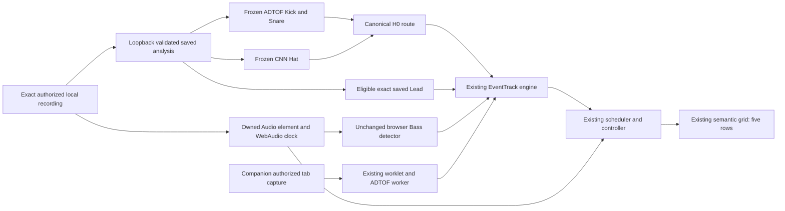

# Hybrid Beta integration and saved Melody playback

Delivered privately on 2026-10-18. The actual Kora Music/Focus application now
offers opt-in **Beat Grid Hybrid — Beta** for owned local playback. Frozen H0
percussion and the existing independent Bass operate on Web and actual Tauri
Desktop. Eligible exact saved Lead references play through the fifth row on Web.
This delivers playback integration; detector accuracy and physical synchronization
remain unverified. No public release, deployment or new installer was made.

Branch: `codex/beat-grid-quality-recovery`.
Base: `a8ca6f4f659d08411b472569cbf69808155d5340`.
Implementation: `15dc6bb174c43b5b5ab95b462daad61edafb6c81`
(`feat(music): integrate private hybrid beta and saved lead playback`).
The following documentation commit and exact changed-file list are recorded in
the post-commit local receipt, `scratch/hybrid-beta/delivery-receipt.json`.

## Decisions and gates

| Required outcome | Result | Scope |
| --- | --- | --- |
| FOUR-ROW OFFLINE BETA | **PASS** | Frozen H0 + unchanged independent Bass; functional integration, not acoustic certification |
| WEB APPLICATION | **PASS** | Actual Edge application; four rows, lifecycle and exact saved Lead tests |
| DESKTOP APPLICATION | **PASS** | Actual Tauri/WebView2 four-row playback; native fifth-row follow-up remains unverified |
| LIVE CNN INFERENCE | **BLOCKED** | Original CNN remains offline; changed normalization diagnostic is not a live browser implementation |
| BROWSER LATENCY COMPARISON | **PARTIAL** | Actual Web/Companion software stages measured; native timing and qualified background/display comparisons missing |
| PHYSICAL AUDIO-VISUAL SYNC | **UNVERIFIED** | No external speaker-to-pixel measurement; p95 ≤50 ms gate has not passed |
| MELODY OFFLINE | **PASS** | Eligible exact saved-reference fifth-row playback on Web; new full-song inference blocked |
| MELODY LIVE | **BLOCKED** | Generating runtime absent; no sustainable live Lead implementation demonstrated |
| LICENSE / DISTRIBUTION | **RESTRICTED** | Private local evaluation only; model/code/audio rights are separate unresolved gates |
| PUBLIC RELEASE | **NOT AUTHORIZED** | No publication, hosted rollout or installer distribution |

The provisional Whiplash/user annotations remain `provisional-human-reference`.
No official precision, recall, F1, note accuracy or unmatched-prediction false
positive count was computed. No thresholds were fitted to user clicks. None of
these integration PASS labels passes the acoustic accuracy gate.

## Architecture and ownership

| Owner | Actual implementation and limits |
| --- | --- |
| Audio/clock | One owned Audio → MediaElementSource → Analyser → destination; no intentional delay; source generations invalidate stale work |
| Permissions | Local file selection/retained authorized recordings; existing Companion source/output/provider checks retained |
| Kick | Frozen ADTOF A predictions only |
| Snare/Clap | Frozen ADTOF A predictions only |
| Hi-Hat | Frozen Frame CNN B predictions only in H0; A Cymbal/Hat and B Kick/Snare are not merged |
| Bass | Existing browser `BeatDetector`, unchanged; live independent row alongside cached percussion |
| Melody/Lead | Existing `melody` wire row and Lead provenance; exact saved `lead-pulse-v1`, dominant-monophonic records only |
| Cache | Existing full-song store validates source, WAV/PCM, duration, sample rate, numerical/component identities and result hashes; H0 retains EOF coverage gaps |
| Scheduling/state | Existing `beat-event-engine`, `beat-scheduler`, `useMusicBeatSync` controller; injected client/transport seams rather than a second pipeline |
| Rendering | Existing BeatPattern/SemanticBeatPattern; Beta-only independent row retention and Original/40 ms Short Attack percussion |
| Desktop | Actual Tauri debug application at the same 1420 development URL; no Rust or distributed CSP change |

Bass uses the existing browser detector on **both owned-local platforms**:
FFT 2048, smoothing 0, 150–400 Hz, 40 ms fast/700 ms average, ratio 1.6 and
120 ms debounce. Native monitored-system-audio Bass remains unchanged at
60–250 Hz. This integration does not claim those detectors are equivalent.
Cached percussion cannot truncate or suppress independent Bass. Focused tests
cover simultaneous Bass/Kick/Hat, cache precedence and row expiry.

Melody uses one attack per saved event with a restrained 150–450 ms
duration-sensitive trail. Pitched notes and vocal articulations retain their
different provenance. Reduced motion uses a static onset indication without
the sharp transform/animation. Normal Beta-off DOM/renderer behavior is retained.

## Entry points and acceptance guide

Start/reuse `node scripts/serve-hybrid-beta.mjs`; the deterministic private server
is [Kora Music](http://127.0.0.1:1420/music). It explicitly enables the private
development flags and local mock authentication. This is not a hosted preview.
Ordinary builds default the Beta off and do not serve the preparation API.

1. Open the link in a browser, or the existing local Tauri debug application.
2. Enable **Beat Grid Hybrid — Beta**. Under **Local recording and visual
   envelope**, choose the prepared Rằng, HSKT or Nujabes recording and verify its
   SHA prefix. A first-time file is processed only on this computer; missing
   runtimes/pending analysis are explicit. Exact retained recordings need no
   neural inference rerun.
3. Press **Play music**, then **Beat grid**. Kick, Snare, Hat and Bass should
   operate. Pause, seek, resume and change recordings through existing controls.
4. Switch **Original / Short Attack** in the collapsible local settings.
   The same source/clock continues. Detailed research controls are closed by
   default. Export a technical trace if investigating a passage.
5. To test Melody separately, choose **Saved Lead reference - gymnopedie** or
   **Saved Lead reference - lee_hi_hskt** and check **Melody / Lead (saved
   analysis)**. These are separate short exact recordings. Their missing H0
   percussion remains unavailable; no events are substituted from the full song.
6. Disable Beta to pause its audio and restore normal provider discovery.

For actual live A comparison, use Chrome/Edge with the existing **private**
Companion built by `node scripts/package-music-extension.mjs --private` at
`scratch/browser-first-candidate/extension`. Enable only one Companion version
and one capture client. Play an authorized source tab, invoke Companion's
toolbar action, select it in normal Music, and use **Private candidate → Live
preview**. Confirm the hearing/permission statements only when true. This route
adds no audio delay. Seek/pause/source changes can revoke preview. Live Hybrid
and live Melody are unavailable; do not label this A baseline H0.

The built-in Codex browser can play the offline Beta but cannot load Companion.
Concurrent Web and Desktop capture clients share Companion's existing single
owner and can replace each other. Close the other capture client for comparison.

## Frozen identities and reuse

Novelty was checked at model weights, preprocessing and detection pipeline level.
An ONNX packaging change is not a new detector. No new model sweep or speculative
threshold tuning occurred. Existing full-song A/B outputs, raw scores, contracts
and saved Lead references were reused. Only named diagnostic inference below
used the changed online-normalization variant; H0 itself remains frozen.

| Identity | SHA-256 / version |
| --- | --- |
| ADTOF A checkpoint | `c571062d76c322d54c2808c95339ea2dadd2f6ab99f9d83163d0f5311cd0f80a` |
| CNN B checkpoint | `785c9b7a8640d78066598bc9da4bba54a2c67464a4b3ae125e322770e9d704db` |
| Routing | `H0-frozen-routing-diagnostic-v1` |
| Canonical H0 algorithm file | `f9e051c2d6dbfbacd76beb7cc17ff88dac9aaf4fb9588d334b0f1e28196a20b0` |
| Frozen numerical implementation | `7cf44ba3b007f7088833b9656b79a49699071e2108d2f2d3af322786eaeee4ae` |
| Numerical contract | `927bd3a00550173ae760eaab42a543b92bba97fa17350d7c929e71acf5a113b9` |
| Existing Lead policy | `lead-pulse-v1`, `server-lead-pulse-range-v1` |
| Lead policy hash | `a9e78c0256fd54367a3377b115ae0f0274701db98f3c18fb15d9b101ad6de07b` |

| Exact recording | Original SHA-256 | Duration / use |
| --- | --- | --- |
| Rằng full song | `edb26dbb975d54ac8fba7f649363772588a1c8ebd1a2d2da5a4a6332332b673a` | 186.108 s; native four-row evidence |
| HSKT full song | `810d0f7d8575bc628c9b4c30383a49ecb547b78bdf73e2a3b805deaabd9e9103` | 204.521 s; source switching |
| Nujabes full song | `349b0b80a4e8f7f206d3fed48ccb6bc938b179a171bbff9ecaf9ec6171145f9f` | 280.242 s; Web four-row evidence |
| Existing generated CC0 control | `0bcf5f5fece49bf67804c8dbdd17099dc971a0f4295070041b31122155c941ff` | 180 s; actual local/capture software comparison |
| Saved Gymnopedie Lead | `7e646f83f8493d1f5c453b3423d64bfe141973aceb372053cbbadfeb8ca4c692` | 30 s; 38 saved pitched notes |
| Saved HSKT Lead | `5c98210e8f24e6d60d5c2cdf3ffc9f581f676a65eeb1a564a54a8483d4b2ab1c` | 30 s; 95 saved mixed events |
| Saved Nujabes Lead | `171f23e5d17dbd4e7a4fcbf0b7a32f72c14776e0e311698cfeb796e7468d6893` | 30 s; 121 saved mixed events |

Full WAV/PCM/component/result/cache hashes and source-specific coverage are in
the ignored exact source manifests and technical exports. The CC0 comparison
canonical WAV is `0f512f74f20bec0a3a00e1d91f781852fbb3e132a68a1326e681b1f41343c517`.
`baseline.json` freezes the original Git blobs and numerical hashes. Registration
of twelve Lead references reports `inferenceRun:false`, `slotsUnchanged:true`.

## Actual application results

**Web:** final actual Edge check recorded Nujabes Kick 11, Snare 17, Hat 34,
Bass 22 at approximately 12 seconds. Original/Short switches preserved source,
play/load/seek counters and playback rate. Pause froze the clock; seeking,
resume, source replacement and Beta-off restoration passed. Exported H0 IDs and
timestamps were checked against the frozen prediction records.

**Desktop:** actual Computer Use observations in Tauri/WebView2, not a mocked
browser, recorded Rằng at 82.788 seconds with Kick 113, Snare 83, Hat 167,
Bass 231; at 172.730 seconds, Kick 361, Snare 240, Hat 549, Bass 528, generation
139. AudioContext was running, estimated base/output latency 10/40 ms,
intentional delay 0. Those estimates do not establish physical synchronization.
Native EOF was observed paused. The final native saved-Lead follow-up reached
the exact piano source and paused controls, but repeated Computer Use
`user input was detected in this window` guards prevented a valid playing
fifth-row observation. An earlier EOF-only observation also does not pass it.
Native Melody playback remains unverified; Web proof is not promoted to native.

**Actual Companion:** Chrome 155.0.8059.80 with private Companion 0.3.24 captured
the CC0 source tab. Preview had `allowTypedPreview:true`, `allowSemantic:false`,
mode `experimental-live`, detector `adtof-onset-valley/1`, buffer 0. The harness
exercised consent routing on its generated source; `humanOutputHeard:false`
explicitly disclaims a human hearing check. Successful runs retained healthy
clock/capture and no preview revocation during the sampled window.

Real testing uncovered a bug: loading notifications for the **app's SPA query
change** called `tabClosed`, stopping an otherwise valid source capture when
switching Music → Beat grid. The fix introduces source-only `tabLoading`.
Actual tab closure, app pagehide, source navigation, transport failure, leases
and consent cancellation still release ownership. A single-Web-client run with
Desktop closed also failed before this fix: multi-client contention was not the
sole demonstrated cause. Additional startup failures came from Vite watching a
locked test-browser profile and absent explicit 1420 relay origins; both were
fixed without widening provider semantic gates.

## Software timing, backlog and missing measurements

The same CC0 file and actual Kora semantic renderer were used for local H0 and
real tab capture. Local Short and Original windows were sequential passages,
not matched acoustic onset sets. Live A and H0 have different predictions;
these figures measure delivery, not comparative recognition accuracy. Quantiles
are empirical order statistics; `n` is joined software observations, not labeled
drum hits. Animation callbacks are browser proxies, not visible physical pixels.

| Foreground path | DOM commit median / p95 / worst ms | Animation median / p95 / worst ms | n commit / animation |
| --- | --- | --- | --- |
| Web local H0 Short | 17.0 / 27.0 / 35.6 | 27.0 / 35.1 / 39.6 | 42 / 42 |
| Web local H0 Original | 14.1 / 29.0 / 30.3 | 25.0 / 35.3 / 35.8 | 29 / 29 |
| Actual Companion live A | 160.8 / 199.2 / 200.5 | 170.1 / 210.2 / 210.4 | 60 / 57 |

Live A had 60 sent/received/scheduled/accepted/committed, 57 animation records,
48 explicit late observations and zero explicit drops in that joined window.
Missing bounded stages or animations are not proof of detector misses or event
transport loss. Capability's four withheld semantic events include startup
before opt-in and are not false positives/recall statistics.

| Joined live A stage, foreground | n | median / p95 / worst ms |
| --- | --- | --- |
| Classifier detection → offscreen emission | 44 | 0 / 0 / 1 |
| Offscreen emission → background receipt | 60 | 1 / 1 / 1 |
| Background send → application receipt | 60 | 1 / 5 / 6 |
| Application receipt → scheduler | 60 | 0 / 0 / 1 |
| Scheduler → controller acceptance | 60 | 0 / 53 / 56 |
| Controller acceptance → DOM | 60 | 8 / 14 / 15 |
| DOM → animation callback | 57 | 9 / 15 / 16 |

These stage quantiles cannot be added. Feature-availability and per-event
inference start/end are unavailable in this trace; worker batch duration is not
that missing per-hit measurement. Nominal A right-context configuration is ten
10 ms frames. Reported processing p95/p99 was 229.9/237.9 ms; measured worker
batch median/p95/worst 18.0/19.5/31.6 ms across 351 batches, maximum observed
queue depth 0. This short bounded run cannot prove sustained zero backlog.

Under two busy worker threads, local Short/Original animation p95 was
38.7/37.3 ms; live A was 228.7 ms, worst 239.1 ms. Live A had 62 accepted,
committed and animated, 50 late and zero explicit drops; processing p95/p99
241.2/251.2 ms, worker-batch p95 29.4 ms, maximum observed queue depth 0.
Harness+load-worker CPU was 85.89 s user +1.125 s system over 48.87 s wall;
RSS 268,926,976 bytes. This is not whole-browser process-tree CPU/RSS.

The background proxy brought another page forward, but reported visibility
stayed `visible` and exported visibility histories were empty. Background timer
throttling was disabled by the harness. Only 3/3/4 animation callbacks were
recorded for Short/Original/live, despite 42/29/57 commits. Treat this as a
headless rendering-suppression observation, **not a confirmed hidden-tab test**.
Its animation quantiles are too sparse to qualify real background playback.

Recognition onset error is **NOT MEASURED** here: no independently verified
complete onset subset was joined. Physical speaker-to-pixel synchronization is
**UNVERIFIED**. Desktop has functional evidence but no joined stage comparison.
60 Hz/high-refresh hardware comparisons, independent quiet/rapid-Hat/overlap
timing strata, long-session backlog and physical p95 ≤50 ms remain unqualified.
No independent delayed video/audio path was added to force parity.

## CNN live feasibility

One separately named diagnostic,
`C1-running-reference-centered-diagnostic-v1`, reused frozen B weights and saved
baseline raw scores. It replaced final global dB reference with a per-frame
observed running maximum, kept threshold 0.5, and retained centered features.
It is a preprocessing variant, not a new model or unchanged original CNN.

Minimum steady future audio is **104.49 ms**:
`(512 + (4 delta + 3 CNN context) × 256) / 22050` seconds. Inference, cadence,
IPC, scheduling and display come afterward. First/end boundary padding still
needs explicit streaming handling. Full-file feature computation in this Python
diagnostic is not an incremental browser STFT implementation.

| Source | Baseline → diagnostic Hat edges | Same frame / removed / added | Batch-32 CPU median / p95 / worst ms |
| --- | --- | --- | --- |
| Rằng | 565 → 577 | 536 / 29 / 41 | 1.83 / 2.17 / 9.62 |
| Nujabes | 871 → 871 | 870 / 1 / 1 | 1.77 / 2.09 / 4.75 |

Rằng active-Hat-frame disagreement was 0.004803, mean absolute score change
0.006138, maximum 0.9151; Nujabes 0.0001657, 0.00006324, maximum 0.7282.
Process RSS was 263.7/306.8 MB. Offline simulation wall times were 16.32/1.91 s
(first includes cold feature-library cost), not live stream latency. Drift is
not accuracy. No threshold search or original-H0 modification followed.

No concurrent browser ADTOF+CNN+Bass sustainable cadence, incremental feature
parity, seek/silence/EOF recovery or long-run backlog proof exists. Rights are
also unresolved. Live CNN therefore remains **BLOCKED / unqualified**; the UI
does not silently substitute another Hat detector under the Hybrid label.

## Melody audit and evaluation

The existing Lead/EventTrack contracts, policy, adapter and renderer are
operational. The intended generating stack is HTDemucs/source selection →
MELODIA/predominant pitch → confidence/contour cleanup → dominant note or vocal
articulation segmentation → cache. The checkout lacks `server/audio-analysis/`,
`modal_kora_jobs.py`, `modal_kora_analysis.py` and `scripts/prepare-lead-demo.py`.
Historical deployment instructions do not establish a runnable service.

Twelve existing fixture recordings and saved analyses were validated and
registered, with matching original hashes, no note overlaps and unchanged user
slots. The adapter checks registry/cache hash, original/WAV/PCM identity,
duration and analysis revision. The client retains MIDI pitch when provided,
confidence, source, detector and pitched-note/articulation kinds. Complete saved
coverage means this exact cached recording scope, not complete human labels.

Actual final Web playback committed five piano Melody events in about 6.5 s.
The subsequent HSKT trace contained 24 cumulative Melody commits (including the
prior piano run), current HSKT note sequence 19; both pitched-note and
vocal-articulation records remained distinguishable. Each selected source had
no saved H0 percussion, which remained absent. Nujabes full-song Lead stayed
disabled. Saved HSKT/Nujabes recordings are not the matching full-song first
30-second PCM: sample comparison correlations were near zero, not offset
evidence. No title-based remapping was made.

The saved corpus also covers synth, rap, rhythmic vocals, guitar, changing jazz,
quiet/sustained material, dense electronic music, polyphonic piano and language
pop. This sprint validates provenance, monophony and playback, not fresh source
separation quality or note recognition. Prior qualitative assessments remain
qualitative. New user listening is pending. No independent note/pitch reference
means no official accuracy score; no fabricated note fills uncertain passages.

Research roles are unchanged: [Mashloop](https://github.com/lvt1693/mashloop)
offers analysis/cache ideas, not a replacement Kora DJ playback architecture;
none was copied. [MuScriptor Large](https://huggingface.co/MuScriptor/muscriptor-large)
is an optional offline reference with access/license/runtime conditions, not a
live dependency; no access conditions were accepted and no weights downloaded.
Beat TCN/Transformer provide rhythm context, not melodic transcription;
Noise-to-Notes/DrumSep are not Melody engines. Missing generating code, rights
and sustainable processing evidence block new full-song/live Melody.

## License, packaging and operational audit

This is an engineering inventory, not legal clearance. Reused pinned license
and dependency inventories remain in ignored `scratch/beat-grid-v2/`.

| Component | Evidence / gate |
| --- | --- |
| ADTOF weights/derivative | Existing `MODEL-NOTICE.txt`: CC-BY-NC-SA-4.0 rights unresolved, local evaluation only; packaging unchanged weights does not clear them |
| Frame CNN | Pinned C1 repository AGPL-3.0; checkpoint and transitive requirements remain separate/unresolved; no CNN code/weights added to application resources |
| HTDemucs | Existing MIT implementation evidence; weights/source-audio conditions must be checked separately; no separation rerun |
| MELODIA / Essentia/plugins | Generating implementation missing here; original plugin/dependency terms not cleared by saved-cache playback |
| Transitive runtime | Existing package metadata inventory reused; metadata is not redistribution certification; private Python environment excluded from resources |
| Audio | User-authorized local investigation and existing CC0 control only; no provider downloads or music redistribution |
| Extension/Desktop | Ordinary 46-file Companion package rebuilt; original A checkpoint unchanged; no newly generated installer or publication |
| Hosted inference | No rollout/API enabled; worker/server isolation does not remove copyleft/network/license obligations |

Production smoke audit passed: Beta checkbox absent, no `/lab/full/` requests,
no JSON analysis endpoint, ordinary Companion `privateBeatCandidate=false`,
inventory excludes new CNN/audio/cache/server files. Existing ADTOF is still
present and restricted; the package is not described as model-free or cleared.
Temporary production test server 4381 closed in finally. Actual 1420 server
PID 14004 is retained for user listening; preparation worker is idle. Test
browser contexts/load workers closed. Desktop was restored, with the exact
piano source paused. Process receipts bind command/PID/port/worktree.

## QA, review and changed files

| Check | Result |
| --- | --- |
| Focused regressions | 79 tests / 8 files PASS |
| Full `pnpm test` | **927 tests / 117 files PASS** |
| Full-song cursor/H0 bridge | 8 Node tests PASS |
| Exact cache/numerical contracts | 6 Python tests PASS |
| New Python scripts | AST parse PASS; diagnostic inference not repeated |
| `pnpm lint` | PASS, 0 errors / 31 warnings retained and disclosed |
| `pnpm build` (includes `tsc -b` and Companion packaging) | PASS |
| `pnpm bundle-size` | PASS: main 735.0 KiB, budget 976.6 KiB; total JS 2046.8 KiB / 34 chunks |
| Actual Web lifecycle and saved Lead scripts | PASS, no page errors |
| Actual native four-row UI | PASS; fifth-row follow-up unverified as described |
| Production/package exclusion smoke | PASS |
| Independent read-only review | DONE, no remaining material regression reported |

Warnings: existing jsdom media-method diagnostics in unit tests; lint includes
effect/dependency warnings, including new local-Beta lifecycle effects. Build
reports the >500 kB chunk advisory and future native-config-loader import
extension advisories (including the new plugin import). They are not hidden.
The diagnostics render-time `Date.now` lint error was fixed using the existing
sampled playback timestamp. Sandbox-only pnpm access and temporary-directory
test failures passed when rerun with the appropriate local execution permission.
Review found and fixed normal-renderer scope and pagehide unsubscribe-before-stop
cleanup. Provider safety/consent tests remain passing.

Implementation files (38) are grouped below; documentation adds the owning
surfaces and this report/plan. Exact commit inventories are in the final receipt.

- Music integration: `MusicPlayer.tsx`, `useBrowserMusic.ts`,
  `useMusicBeatSync.ts`, `beat-event-engine.ts`, `BeatPattern.tsx`,
  `SemanticBeatPattern.tsx`, `hybrid-beta-control.tsx`,
  `use-local-hybrid-music.ts`, `local-audio-transport.ts`,
  `local-hybrid-track.ts`, plus `src/components/focus/floatingFocus.css`.
- Music tests: `beat-event-engine.test.ts`, `useMusicBeatSync.test.ts`,
  `beat-row-diagnostics.test.tsx`, `local-hybrid-track.test.ts`.
- Loopback/store: `server/vite-local-hybrid-plugin.ts`, `local-lead-cache.mjs`
  and its declaration; `scripts/full-song-store.mjs` and declaration;
  `vite.config.ts`.
- Preparation/verification: `serve-hybrid-beta.mjs`,
  `register-saved-lead-inputs.py`, `measure-cnn-online-feasibility.py`,
  `measure-hybrid-browser-latency.mjs`, `verify-hybrid-beta.mjs`,
  `verify-hybrid-lead.mjs` in `scripts/`.
- Companion: `background.js`, `beat-sync.js`, `beat-telemetry.js`, `protocol.js`,
  `relay.js`, `sites.js`; corresponding private-sync/telemetry/relay/sites tests
  and `beat-detector.d.ts`. Detector JS/weights remain unchanged.
- Owning docs: [private operation](../../docs/private-acoustic-visual-lab.md),
  [cache contracts](../../docs/beat-event-cache.md),
  [plan](../261018-1525-hybrid-beta-melody/plan.md). The existing local ignored
  `docs/server-beat-analysis.md` also records missing runtime availability.

Private evidence root: `scratch/hybrid-beta/`. Key receipts: `baseline.json`,
`web-verification.json`, `desktop-verification.json`, `lead-verification.json`,
`browser-latency-comparison.json`, `browser-latency-stress.json`,
`browser-latency-background.json`, `stage-latency-summary.json`,
`cnn-online-feasibility.json`, `saved-lead-registry.json`,
`lead-source-comparison.json`, `packaging-audit.json`, final QA logs and
`delivery-receipt.json`. Audio, checkpoints, raw traces and profiles stay ignored.
No secrets, audio or weights are included in these commits.

## Remaining limits and rollback

Known false/missed CNN Hats are preserved; no filter trades away rapid-Hat
recovery. Source-specific EOF gaps, unavailable new Lead analysis, native fifth
row verification, browser hidden-state/display evidence, physical alignment and
rights remain open. The default provider UI and its degraded fallback keep their
prior policy. One-owner capture limits concurrent clients. No claim of 99%
recognition, live Hybrid parity or validated human onset accuracy is made.

Disable Beta to return to baseline immediately. Revert the implementation commit
to remove the private integration; saved A/B/Lead caches remain separately
reusable. Stop the tracked 1420 process when local listening is no longer needed;
do not start another server on an incremented port.
