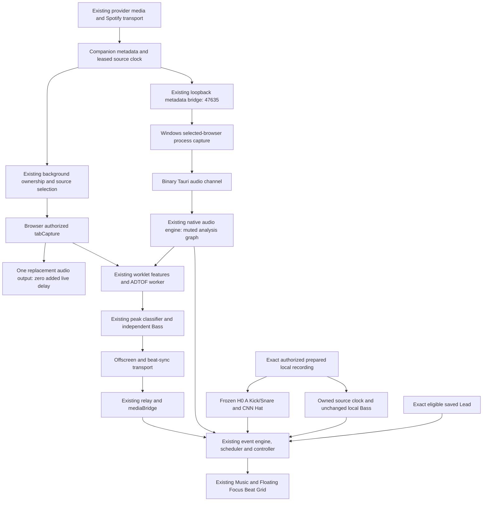

# Existing-provider live Beat Grid investigation

Private development delivery, 2026-10-19, Asia/Saigon.
Branch `codex/beat-grid-quality-recovery`; starting commit
`f378fef209793b0ee26cd98b354a5d9b21b0d8c0`.

The seven existing providers, Companion, native capture, player and scheduler
remain intact. New opt-in timing distinguishes model context, finalization,
transport and presentation without changing learned decisions. Three repeated
foreground trials, a two-thread stress trial and a complete 180-second source
session exercised the actual Companion and Kora Music/Floating Focus component.
Live ADTOF animation p95 was 206–220 ms in the repeated trials. No avoidable
200 ms IPC stall or qualified latency reduction was established. No detector
threshold, weight, numerical preprocessing or H0 routing was changed.

Real-provider checks now include **functional, user-consented YouTube live ADTOF
delivery**. All-provider semantic validation remains **PARTIAL**. The user selected Brave;
initially its Kora page showed **Add music controls** after Check again. The user
reported reloading **v14**, still without a source. Source at the original
Companion 0.3.14 release (`bdd9759`, `relay.js`) excludes port 1420, explaining
that version's inability to handshake with this app origin. Reload is not a
file update. The current private 0.3.24 package was rebuilt; its relay includes
1420, and the user updated from the supplied unpacked folder. Actual Kora UI
then discovered Apple Music and YouTube sessions. Apple Music's metadata/clock
and Kora pause/resume worked; its protected-source capability explicitly blocked
private capture/analysis. The UI's misleading reconnect advice was corrected to
explain that restriction before pause/calibration/permission suggestions.
The user then selected and enabled an authorized YouTube source. Actual Kora
received all four row types and displayed colored grid cells. Changing videos
correctly revoked preview; user re-enabling restored delivery. A new grid status
explains this source-bound reset and where to enable preview again.
Installed files remain uninspected: browser tools forbid internal extensions
pages, and no alternate enumeration was attempted. Brave Spotify's own play/pause
worked and was restored paused. This is not proof of its connection to Kora.

## Decisions and evidence gates

| Gate | Result and boundary |
| --- | --- |
| Existing provider contracts | PASS regression suite; exact host identities, Spotify transport and permissions unchanged |
| Timing observability | PASS opt-in, bounded numeric fields; feature/decision parity tests |
| Controlled live source | PASS functional delivery using existing CC0 recording and actual private Companion; buffer 0 |
| Complete-source continuity | PASS 180-second run, five-second health samples plus lifecycle records; not multi-hour qualification |
| Actual Web Music/Focus | PASS four local rows, controls, switching, Beta-off and exact saved Lead |
| Actual Desktop local H0 | Reused prior actual Tauri four-row evidence; no fresh native per-stage timing |
| Real-provider-to-Kora | PASS functional Brave YouTube live ADTOF and Apple Music metadata/clock/Kora pause-resume; protected semantic preview blocked; no all-provider capture PASS |
| Live Hybrid CNN | BLOCKED / unqualified; existing feasibility evidence reused |
| Acoustic accuracy | UNVERIFIED; no official onset scores or definite unmatched false-positive labels |
| Physical synchronization | UNVERIFIED; no speaker-to-pixel calibration or physical ≤50 ms PASS |
| Distribution | RESTRICTED private evaluation; no deployment, publication or new installer |

Whiplash annotations remain `provisional-human-reference`. Listening feedback,
predicted timestamps and event counters are not complete verified acoustic
references. No Precision/Recall/F1 or official onset-error estimate is produced.

## Existing provider support and new observations

All seven providers already use `sites.js`, manifest host access, the shared
DOM/detached-media observer, Media Session metadata, leased clocks and existing
source picker. Spotify retains its separate song/transport handling. Unsupported
controls stay disabled. Ordinary browser capture attempts are distinct from
private semantic policy and are not guaranteed to be audible for every source.

| Provider | Already implemented / historical evidence | New check and remaining limit | Fixed here |
| --- | --- | --- | --- |
| YouTube | Exact hosts, video clock/control, shared capture and source lifecycle | Actual Brave Kora discovery and user-authorized live ADTOF functional check passed; video change revokes preview, re-enabling restores it; original playback undelayed | No provider code change; grid now explains preview reset |
| YouTube Music | Same observer/capture; README records prior actual Brave capture | Edge page/account available; new Kora end-to-end pending | No provider code change |
| Spotify Web | Dedicated transport plus common discovery/capture; README records earlier Brave ordinary capture | Brave signed-in player advanced 10→25→35 s, then paused. Kora connection pending. Private semantic preview remains policy-blocked | No provider code change |
| Apple Music Web | Shared controls/capture; README records earlier Brave capture | Initially sign-in UI visible. Later actual selected source discovered; clock advances and Kora pause/resume works, playing state restored. Private analysis explicitly blocked for protected-source; account entitlement not inferred | Correct protected-source guidance in existing controls |
| SoundCloud | Shared path; README records prior actual Brave capture/recovery | Edge public page accessible; sign-in/cookie controls visible. No new player/capture qualification | No provider code change |
| Deezer | Exact hosts, common observer/control/capture | Shared-path regression coverage; new account playback not tested | No provider code change |
| Tidal | Exact bare/www/listen hosts, common observer/control/capture | Shared-path regression coverage; new account playback not tested | No provider code change |

Historical ordinary-capture observations in the
[Companion README](../../extensions/kanban-music/README.md) are scoped to their
then-current tracks, browser and implementation. They are not renewed private
semantic or acoustic certifications. Ordinary capture can attempt encrypted-media
elements without decrypting them; actual browser denial/silence retains clock
fallback. The private `beat-mode.js` Spotify/protected-source restrictions remain.
No provider audio was downloaded or uploaded to a cloud service. Only the
user-authorized YouTube source was analyzed locally through Companion. Protected
Apple Music and policy-blocked Spotify were not analyzed.

## Preserved Browser and Desktop architecture



Browser tab capture uses the existing active-toolbar permission and captured-tab
ownership guards. Native monitoring leaves original browser output untouched.
Native PCM uses the existing binary Tauri channel, not the metadata WebSocket.
Native analysis-feed buffering is not intentional speaker delay or calibration.
Selected-process capture may include overlapping audio from that browser; it
does not promise isolated source identity. Source generations, leases, packet
sequence checks and bounded queues are preserved.

Local H0 uses ADTOF A Kick/Snare and frozen Frame CNN B Hat. Provider live uses
ADTOF for all three drum rows, with independent Bass. The existing live-preview
control now states this distinction. Local browser Bass remains 150–400 Hz;
native monitored-process Bass remains 60–250 Hz. These unchanged paths are not
claimed equivalent. Saved Lead requires an exact eligible recording/cache.

## Frozen identities and CNN feasibility

Before benchmarking, the prior hashes, numerical pipeline and canonical H0
routing were compared and retained. ONNX format is not a new technology.
No duplicate CNN inference experiment or model/threshold sweep was run.

| Artifact | SHA-256 |
| --- | --- |
| ADTOF A weights | `c571062d76c322d54c2808c95339ea2dadd2f6ab99f9d83163d0f5311cd0f80a` |
| Frame CNN B weights | `785c9b7a8640d78066598bc9da4bba54a2c67464a4b3ae125e322770e9d704db` |
| `scripts/full-song-numerics.py` | `7cf44ba3b007f7088833b9656b79a49699071e2108d2f2d3af322786eaeee4ae` |
| `scripts/hat-recovery-core.py` | `f9e051c2d6dbfbacd76beb7cc17ff88dac9aaf4fb9588d334b0f1e28196a20b0` |
| Reused CNN feasibility JSON | `b1d680a03e18ef65d1af7d13484ecd9f69b5f4b0d67a0ead8edabc176d06cab6` |

Reused `C1-running-reference-centered-diagnostic-v1` changes full-recording
normalization to an observed running maximum. Its centered FFT, future delta
and CNN context require at least **104.49 ms future audio**, before inference,
IPC and presentation. Rằng Hat edges changed 565→577: 536 identical edge frames,
29 removed and 41 added. Nujabes changed 871→871: 870 identical, one removed and
one added. These are prediction disagreements, not verified errors or gains.
Fast Python batch inference does not demonstrate sustainable concurrent browser
ADTOF + CNN + Bass, streaming feature/boundary equivalence or recognition quality.
Live CNN therefore stays unavailable; offline H0 remains frozen and usable.

The missing HTDemucs/MELODIA full-song generating runtime is a separate follow-up
dependency. Saved Lead playback remains available; this task does not replace
that runtime or redesign provider integration.

## Repeated software delivery measurements

Actual Kora app, private Companion 0.3.24, Chrome 155.0.8059.80, generated CC0
180-second source SHA `0bcf5f5fece49bf67804c8dbdd17099dc971a0f4295070041b31122155c941ff`.
Canonical WAV SHA `0f512f74f20bec0a3a00e1d91f781852fbb3e132a68a1326e681b1f41343c517`.
Desktop closed during single-owner browser measurements. Isolated headless
browser; background throttling disabled. Heavy QA/builds ran afterward.

Stable IDs join software targets to DOM/animation callbacks. These targets are
model predictions, not independently verified acoustic onset times. Headless
callbacks do not measure visible physical pixels. Local H0 and live A have
different predictions; sequential passages and different detectors are not a
pure transport A/B or recognition comparison. `n` is software observations.

| Scenario | Local H0 Short / Original animation p95 ms | Live A animation median / p95 / worst ms | Live commit / animation n |
| --- | --- | --- | --- |
| Foreground 1, 20 s live | 47.2 / 47.6 | 193.1 / 219.9 / 221.1 | 85 / 83 |
| Foreground 2, 20 s live | 34.5 / 31.0 | 169.7 / 206.3 / 216.8 | 89 / 86 |
| Foreground 3, 20 s live | 35.6 / 35.0 | 197.3 / 210.2 / 224.8 | 82 / 82 |
| Two busy worker threads, 60 s live | 29.6 / 30.4 | 184.4 / 205.6 / 223.0 | 223 / 221 |
| Complete source, 180 s | Not sampled in this run | 183.1 / 204.6 / 256.6 | 683 / 676 |

Local samples are ten seconds per envelope. Missing animation/stage observations
are not labeled dropped hits. The full-source run committed 683 accepted events;
523 were late relative to their software target. Zero explicit semantic delivery
drops were observed in that joined window. Startup capability counters included
two withheld/reset predictions; these are not acoustic false negatives. The
fixture yielded Snare/Hat/Bass but no Kick events, so it supplies no new live Kick
latency sample. Separate actual local four-row tests below exercise Kick.

Per-type full-session animation p95: Snare **204.2 ms** (206), Hat **205.3 ms**
(296). Bass is an independent detector and must not dilute learned-drum latency.
The receipt retains its separate values and any missing measurements.

### Where the delay occurs

| Stage | Observation | Interpretation |
| --- | --- | --- |
| Peak feature availability | 33–63 ms run medians | Includes centered FFT and batch position; not just FFT compute |
| Model future + batch | 110–140 ms run medians, 140 ms observed worst | Existing 100 ms right context plus five-frame cadence |
| Final input centered FFT | 23.22 ms | Future samples required for the final input frame |
| Feature FFT compute | p95 1–2 ms per posted batch, coarse epoch clock | Not the 200 ms bottleneck |
| Worklet→worker / worker queue | p95 0–1 ms each | No persistent backlog observed |
| Accepted-peak inference | p95 20–27 ms | Full run median 18 / p95 20 / worst 25 ms |
| Peak finalization | 50 ms audio advancement; wall p95 51–53 ms | Existing grouping must see subsequent scores; changing it changes semantics |
| Result→capture | p95 1 ms | No demonstrated large IPC stall |
| Offscreen→background / background→app | p95 1 / 2–6 ms | Full run occasional maxima 50 / 45 ms |
| App→scheduler | p95 0–1 ms | Existing scheduler entry is not dominant |
| Scheduler→controller | median 0–1; mixed p95 52–55 ms | Includes correctly waiting for future Bass deadlines; not an avoidable drum stall |
| Controller→DOM | p95 11–24 ms | Full run p95 11 ms |
| DOM→animation | p95 13–15 ms | Full run worst 79 ms; still a software callback |

Quantiles are not additive, stages overlap, and audio-time advancement differs
from wall-clock duration. In particular, peak feature availability overlaps the
model input-context window; these rows must not be summed into a latency budget.
The dominant structural delay is ADTOF context/cadence plus peak finalization.
No speculative shortcut was applied to those semantics. Variation between runs
is not a validated optimization. The delivered improvements are traceability,
mode clarity and stricter stability measurement, not a claimed speed gain.

## Stability, lifecycle and actual UI

The final complete-source run recorded 32 healthy playing samples and natural
EOF, zero unhealthy samples, zero unexpected mid-session lifecycle records and
maximum worker queue depth 0. All 3,487 sampled worker batches completed;
duration median/p95/worst was 18.2/20.0/40.6 ms. The only capture stop occurred
3 ms after the source's actual `ended` event. Offscreen release at EOF was
expected. The two-thread 60-second stress trial also had maximum queue depth 0,
with 1,262 batches at p95 21.3 ms. This is bounded stress evidence, not proof
against every CPU/device load, silent gap, background throttle or multi-hour leak.

An initial full-session harness failed querying a document already closed at
normal EOF. That failed receipt is preserved. The harness now tolerates missing
offscreen diagnostics only after the actual source reports ended. Review also
required healthy pre-EOF samples and rejection of unexpected revocation,
replacement, stop, worker/backlog or transport failure. Exact EOF timestamps and
a narrow 100 ms cleanup allowance prevent an early capture failure from being
misreported as a successful source session. Unit tests cover that distinction.

New actual Web Music/Floating Focus component verification passed:

- Nujabes H0 at ~12 seconds: Kick 11, Snare 17, Hat 34, Bass 22.
- Original/Short switches kept the same source, clock, playback rate and
  play/load/seek counts. Pause froze time; seek/resume worked.
- Switching to HSKT replaced the owned recording/generation; disabling Beta
  paused local audio and restored normal discovery.
- Saved Gymnopedie and exact HSKT Lead committed notes in the existing fifth row;
  the similarly titled full song correctly had no eligible Lead cache.
- Actual Brave Kora selected Apple Music, showed advancing position and controlled
  pause/resume. Original playback state was restored. Capture capability reported
  protected-source with analysis/capture false; no protected audio was analyzed.
- The user selected an authorized YouTube source and enabled the existing live
  consent controls. First observation: Kick 3, Snare 1, Hat 2, Bass 11. After a
  video change, capture remained healthy but source-bound preview was revoked.
  User re-enabling restored `experimental-live`, healthy capture/clock, buffer 0
  and typed preview. Later counters rose from 50/14/101/98 to 82/19/129/165, then
  139/52/204/244. A screenshot shows active colored cells in the actual normal
  grid (`brave-youtube-active.png`). These are functional software observations,
  not independently verified hit labels, per-row animation timing or physical
  speaker-to-pixel proof. The 64 withheld/reset counter included the preview-off
  interval and must not be treated as acoustic misses.
- Real Companion tests switched local Beta→normal source→Beat grid while capture
  stayed active. Existing provider/lifecycle tests passed for ownership, source
  navigation, closed tabs, permission denial, paused sources, stale generations,
  native monitor-only feed and independent Bass.

These browser tests exercise the actual app's Floating Focus panel, not a new
detached OS-window claim. Prior actual Tauri/WebView2 H0 evidence is reused from
the [previous delivery](engineering-261018-1525-hybrid-beta-melody.md): Rằng at
82.788 s had 113/83/167/231 row events; at 172.730 s, 361/240/549/528.
Native fifth-row and joined native live capture timing remain unverified.
No Desktop local H0 latency number is inferred from Web evidence.

## Reproducible listening checks

Reuse the deterministic private server:
`node scripts/serve-hybrid-beta.mjs`,
[Kora Music](http://127.0.0.1:1420/music). Check the port owner first; do not
start duplicates. This is local-only development, not a hosted deployment.
For H0, enable **Beat Grid Hybrid — Beta**, select an exact prepared authorized
recording, play and choose **Beat grid**. Saved Lead is separately opt-in.

For providers, disable local Beta and use one Kora capture client in the same
Brave profile as Companion. Close competing Web/Desktop capture clients. If
**Add music controls** remains, use the existing installation guide or manually
reload the installed Companion and refresh both tabs. Enabled does not prove
the app handshake, host access or capture permission. Do not install a second
copy alongside the existing one.

| Source | Scoped test procedure |
| --- | --- |
| YouTube / Music | Play a permitted source, wait past ads, select its actual session in Kora. Check title/clock and play/pause before capture. Invoke Companion on that source tab if permission is requested. Video stays undelayed |
| Spotify | Check normal discovery, source selection, clock and provider-permitted play/pause/seek. Private semantic analysis remains blocked; do not use another route to bypass that policy |
| Apple Music | Sign in in the source tab if required; check accessible player controls and Kora clock. Capture is conditional on browser permission, audibility and applicable rights/protection. Account presence is not analysis consent |
| SoundCloud | Use an accessible permitted player, resolve its ordinary account/consent UI as appropriate, then check discovery, clock and controls. Capture only if authorized and audible |

Only for audio where analysis is authorized and private policy allows it: use
the existing private Companion package built with
`node scripts/package-music-extension.mjs --private`, then its existing **Private
candidate → Live preview** controls. Confirm the three permission/hearing/late
preview statements only if true. Keep the source playing and enable **Live
preview (no audio delay)**. Expect `experimental-live`, ADTOF, buffer 0 and
unverified predictions. Pause/seek/source changes revoke preview; re-enable
against the fresh source/generation. If capture is denied, silent, protected or
policy-blocked, retain honest clock fallback; do not force semantic events.
No provider stream download or model-input substitution is part of this test.

Controlled software measurement, with Desktop closed and a previously prepared
CC0 fixture/private package available:

```text
node scripts/measure-hybrid-browser-latency.mjs --live-ms=20000 --output=scratch/provider-live-upgrade/trial-new
node scripts/measure-hybrid-browser-latency.mjs --stress --live-ms=60000 --output=scratch/provider-live-upgrade/stress-new
node scripts/measure-hybrid-browser-latency.mjs --capture-only --full-session --output=scratch/provider-live-upgrade/full-new
node scripts/summarize-beat-delivery.mjs scratch/provider-live-upgrade/full-new/foreground-latency-live-a.json
```

Create each output directory first; preserve old trials. Diagnostics are opt-in
before worker initialization, numeric-only and locally bounded (2,048 records
per realm; harness polls into bounded 100,000-record maps). Raw score/feature
diagnostics remain off. The automated CC0 consent-routing check explicitly
records `humanOutputHeard:false`; it is not a human audibility attestation.
Turn diagnostics off and reacquire capture after measurement. Do not run heavy
builds during timing comparisons. Background/full-session combined mode is
rejected because that combination has not been qualified.

## Changed files and validation

| Files | Necessary change |
| --- | --- |
| `extensions/kanban-music/percussion-features.js` | Optional feature-post/availability/coarse compute timing, exact arrays preserved |
| `extensions/kanban-music/percussion-worker.js` | Optional worker/inference/input and delayed decision boundaries |
| `extensions/kanban-music/percussion-classifier.js` | Carry original peak timing through existing bounded finalization |
| `extensions/kanban-music/percussion-runtime.js` | Enable timing independently of raw score/feature diagnostics |
| `extensions/kanban-music/capture-engine.js` | Join learned timing to existing event IDs without changing event transport |
| `extensions/kanban-music/beat-telemetry.js` | Bounded finite numeric allowlist and `DETECTOR_TIMING` stage |
| `percussion-features.test.js`, `percussion-classifier.test.js`, `percussion-runtime.test.js`, `beat-telemetry.test.js` in that extension | Numeric/decision parity, opt-in and privacy regression checks |
| `scripts/measure-hybrid-browser-latency.mjs` | Repeated output folders, bounded long collection, real EOF and continuity checks |
| `scripts/summarize-beat-delivery.mjs` | Stable-ID per-band stage analysis; missing measurements remain unavailable |
| `scripts/summarize-beat-delivery.test.mjs` | EOF cannot hide failure; future Bass wait is not drum lag; clock units/missing stages |
| `src/features/music/experimental-live-preview-control.tsx`, `experimental-beat-control.tsx` | Explain live ADTOF versus H0; prioritize protected/provider-policy reasons over misleading reconnect/calibration advice and disable unusable controls |
| `src/features/music/experimental-live-preview-control.test.tsx`, `experimental-beat-control.test.tsx` | Protected and provider-policy states retain unavailable actions without reconnect/pause advice |
| `src/features/music/MusicPlayer.tsx`, `live-player-diagnostics.test.tsx` | Show private grid preview status and source-change re-enable guidance; normal/local Beta behavior stays unchanged |
| `extensions/kanban-music/README.md` | Document current opt-in timing, measurement boundaries and the old 0.3.14/1420 setup mismatch |
| `plans/261019-0549-provider-live-upgrade/plan.md`, this report | Accepted scope, progress, results and remaining gates |

Focused instrumentation Vitest: **33/33**. Final focused player/guidance checks:
**61/61**. Final full Vitest: **936/936 across 117 files**.
Node measurement tests: **3/3**. Typecheck passed. Full lint passed with
**31 warnings, zero errors**: unchanged application warnings plus local
third-party scratch warnings. Test logs also retain jsdom media-method warnings;
actual browser playback checks passed. Ordinary build and 46-file Companion
packaging passed; bundle limits passed (737.1 KiB entry, 976.6 KiB budget).
Build logs retain existing extensionless-config imports and >500 kB chunk
warnings. The private 46-file 0.3.24 package was rebuilt separately. Exact
package validation and post-commit inventory are in the local delivery receipt.
Read-only cross-module timing/continuity review completed with no remaining
concerns after the EOF qualification fixes.

## Remaining limits and handoff

The Brave Companion handshake and authorized YouTube preview now work after the
package update. Remaining
provider smoke checks depend on player access, capture grant, audible output and
analysis rights are separate prerequisites. Do not equate source discovery with
capture or inference permission. No provider detection regression was found in
the shared tests; those tests cannot renew every external service/account claim.

Acoustic qualification needs a separately verified, complete reference subset
with sufficiently accurate onset times and explicit uncertain intervals.
Physical timing needs calibrated speaker/display measurement. Native per-stage
timing, background presentation, multi-hour stability, live CNN quality/budget
and new full-song Melody generation remain open. Model/code/audio rights stay
separate; nothing here authorizes redistribution or public rollout.

Machine evidence remains ignored under `scratch/provider-live-upgrade/`:
`baseline-identities.json`, `performance-summary.json`, `stage-comparison.json`,
the preserved per-trial/full-session receipts, `provider-observations.json`,
quality/UI logs and `delivery-receipt.json`. Test browsers and load workers close
in cleanup; retain only the user-facing 1420 server with its PID/command/worktree
in `scratch/hybrid-beta/server-process.json`.
